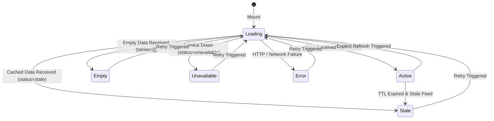

# Data Model: Economic Indicator Dashboard

**Feature**: [001-economic-indicator-dashboard](file:///Users/tejaspatare/Documents/AdityaBirla/Economics-Indicator/specs/001-economic-indicator-dashboard/spec.md)  
**Date**: 2026-10-15  
**Status**: Approved

This document defines the TypeScript interfaces, domain entities, validation constraints, and lifecycle state machines governing the Economic Indicator Dashboard.

---

## 1. Domain Entities & Interfaces

### 1.1 Generic Indicator Envelope
Every indicator endpoint returns data conforming to this unified envelope:

```typescript
export type SourceType = 'NSE' | 'external';
export type IndicatorStatus = 'ok' | 'stale' | 'unavailable';

export interface IndicatorEnvelope<TValues, TSeries> {
  id: string;                      // e.g. "gdp-growth", "debt-to-gdp"
  title: string;                   // Display title, e.g. "GDP Growth - India vs World"
  subtitle?: string;                // e.g. "(YOY%)", "(IND)"
  source: string;                  // e.g. "Ministry of Statistics (MoSPI)", "RBI"
  source_type: SourceType;         // 'NSE' or 'external'
  as_of: string;                   // e.g. "2024-03-31", "FY 2024-25 Q3"
  status: IndicatorStatus;         // Server reported status
  values: TValues;                 // Key KPI stat tile metrics
  series: TSeries;                 // Time-series array for ECharts visualization
}
```

---

### 1.2 Stat Tile Metric Data Model
Represents individual KPI tiles rendered at the top of each panel:

```typescript
export type DeltaDirection = 'positive' | 'negative' | 'neutral';

export interface StatTileMetric {
  label: string;                   // e.g. "India", "World", "Total Expenditure"
  value: number | string | null;   // e.g. 4.82, 382.9, or null (renders as "—")
  formattedValue?: string;         // e.g. "4.82%", "$382.9 B"
  unit?: string;                   // "%", "$ B", ""
  delta?: number | null;           // e.g. -0.2, -0.81, null
  formattedDelta?: string;         // e.g. "-0.2pp", "▲ -0.81pp"
  deltaUnit?: string;              // "pp"
  deltaDirection: DeltaDirection;  // 'positive' (green) | 'negative' (red) | 'neutral'
  sublabel?: string;               // Optional qualification, e.g. "(FY25)"
  iconKey?: string;                // Identifier for artwork or flag (e.g. "india-flag", "world-globe")
}
```

---

### 1.3 Panel-Specific Data Contracts

#### Panel 1: GDP Growth (India vs World)
```typescript
export interface GdpGrowthValues {
  india: StatTileMetric;           // 4.82%, -0.2pp
  world: StatTileMetric;           // 3.82%, -0.81pp
}

export interface GdpGrowthPoint {
  year: string;                    // "2021", "2022", "2023", "2024", "2025"
  indiaRate: number | null;        // e.g. 8.7
  worldRate: number | null;        // e.g. 6.3
}

export type GdpGrowthSeries = GdpGrowthPoint[];
```

#### Panel 2: Debt to GDP Ratio (IND)
```typescript
export interface DebtToGdpValues {
  indiaFy25: StatTileMetric;       // 3.82%, -0.81pp
  indVsUs: StatTileMetric;         // 3.82%, -0.81pp
}

export interface DebtToGdpPoint {
  date: string;                    // "25 Jul", "1 Aug", "8 Aug", "15 Aug", "22 Aug"
  ratio: number | null;            // e.g. 80.5, 70.2, 58.4, 72.1
  isHighlighted?: boolean;         // true if a pill badge is rendered
  highlightLabel?: string;         // e.g. "6.3%"
}

export type DebtToGdpSeries = DebtToGdpPoint[];
```

#### Panel 3: Imports, Exports & Trade Balance
```typescript
export interface TradeBalanceValues {
  exports: StatTileMetric;         // $382.9 B, -0.81pp
  imports: StatTileMetric;         // $382.9 B, -0.81pp
}

export interface TradeBalancePoint {
  year: string;                    // "2021", "2022", "2023", "2024", "2025"
  importsValue: number | null;     // e.g. 8.7 (represented in bars)
  exportsValue: number | null;     // e.g. 6.3 (represented in bars)
  tradeBalance: number | null;     // e.g. 6.3 (represented in green line with pills)
}

export type TradeBalanceSeries = TradeBalancePoint[];
```

#### Panel 4: GST Tax Collection (YOY%)
```typescript
export interface GstCollectionValues {
  collections: StatTileMetric;     // 3.82%, -0.81pp
  monthlyAverage: StatTileMetric;  // 1.97, -0.81pp
}

export interface GstCollectionPoint {
  year: string;                    // "2021", "2022", "2023", "2024", "2025"
  collectionRate: number | null;   // e.g. 8.7 (blue bars)
  averageRate: number | null;      // e.g. 6.3 (yellow trendline)
}

export type GstCollectionSeries = GstCollectionPoint[];
```

#### Panel 5: Inflation (IND)
```typescript
export interface InflationValues {
  inflationRate: StatTileMetric;   // 2.1%, -0.2pp
  rbiTarget: StatTileMetric;       // 4%, -0.2pp
}

export interface InflationPoint {
  year: string;                    // "2021", "2022", "2023", "2024", "2025"
  cpiRate: number | null;          // Cyan line rate
  isHighlighted?: boolean;
  highlightLabel?: string;         // e.g. "6.3%"
}

export type InflationSeries = InflationPoint[];
```

#### Panel 6: Government Expenditure
```typescript
export interface GovtExpenditureValues {
  totalExpenditure: StatTileMetric;   // 4.82%, -0.2pp
  capitalExpenditure: StatTileMetric; // 3.82%, -0.2pp
}

export interface GovtExpenditurePoint {
  year: string;                    // "2021", "2022", "2023", "2024", "2025"
  revenueExpenditure: number | null; // e.g. 7.9 (blue stacked segment)
  capitalExpenditure: number | null; // e.g. 23.2 (orange stacked segment)
  totalExpenditure: number | null;   // e.g. 31.2 (sum labeled on bar top)
}

export type GovtExpenditureSeries = GovtExpenditurePoint[];
```

---

### 1.4 Real-Time Market Ticker Quotes
```typescript
export interface TickerQuote {
  symbol: string;                  // "SENSEX", "NIFTY BANK", "NIFTY IT"
  currentPrice: number;            // 73158.24
  changePoints: number;            // +305.10 or -56.30
  changePercent: number;           // +0.42 or -0.12
  isPositive: boolean;             // true for green (#69F6B8), false for red (#FF716A)
  updatedAt: string;               // ISO 8601 string
}

export interface TickerStreamPayload {
  timestamp: string;
  quotes: TickerQuote[];
}
```

---

### 1.5 Authentication & User Session
```typescript
export interface AuthUser {
  id: string;
  email: string;
  name: string;
  role: 'analyst' | 'admin';
}

export interface AuthSessionState {
  user: AuthUser | null;
  accessToken: string | null;      // Strictly in-memory
  expiresAt: number | null;        // Unix epoch ms
  isAuthenticated: boolean;
  isLoading: boolean;
}

export interface LoginResponse {
  user: AuthUser;
  accessToken: string;
  expiresInSeconds: number;
}
```

---

## 2. Panel Lifecycle State Machine

Each panel card transitions through discrete states:



### State Render Rules
| State | Visual Treatment | Missing Value Behavior |
| :--- | :--- | :--- |
| **Loading** | Render animated dark skeleton matching exact card and chart dimensions. | N/A |
| **Active** | Full visual rendering of stats and ECharts canvas. | Any null metric renders as `"—"`. |
| **Stale** | Normal chart/stat presentation with an overlaid or header `"STALE"` badge. | Retains cached figures; null renders as `"—"`. |
| **Empty** | Centered empty dataset illustration and `"No data reported for this period"`. | All metrics render as `"—"`. |
| **Unavailable** | Warning banner and `"Data feed temporarily decommissioned or unavailable"`. | All metrics render as `"—"`. |
| **Error** | Destructive notification banner with `"Failed to load indicator"` and a `[Retry]` action. | All metrics render as `"—"`. |

---

## 3. Data Integrity & Validation Rules

1. **Strict Non-Fabrication**: Under no circumstances should missing or undefined numerical data be defaulted to `0` or interpolated. If `value == null`, display `"—"`.
2. **Attribution Requirement**: Every indicator panel MUST contain a non-empty `source` string and `as_of` date. If `source_type === 'external'`, a visual badge or text indicator highlights the non-NSE provenance.
3. **Stacked Sum Consistency**: For Panel 6 (Expenditure), if either `revenueExpenditure` or `capitalExpenditure` is null, `totalExpenditure` must render as `"—"` rather than displaying partial totals.
