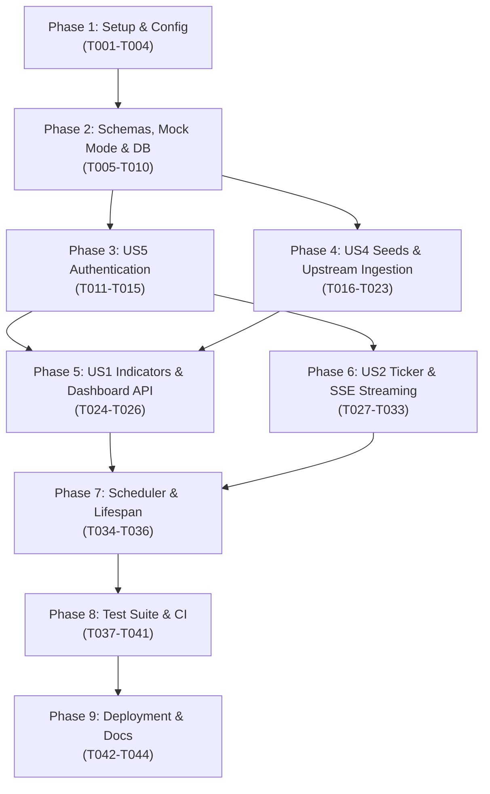

# Implementation Tasks: Economic Indicator Dashboard (FastAPI Backend & Integration)

**Feature**: [001-economic-indicator-dashboard](file:///Users/tejaspatare/Documents/AdityaBirla/Economics-Indicator/specs/001-economic-indicator-dashboard/spec.md)  
**Date**: 2026-10-16  
**Status**: Ready for Implementation  
**Plan**: [plan.md](file:///Users/tejaspatare/Documents/AdityaBirla/Economics-Indicator/specs/001-economic-indicator-dashboard/plan.md) | **Data Model**: [data-model.md](file:///Users/tejaspatare/Documents/AdityaBirla/Economics-Indicator/specs/001-economic-indicator-dashboard/data-model.md) | **Contracts**: [contracts/](file:///Users/tejaspatare/Documents/AdityaBirla/Economics-Indicator/specs/001-economic-indicator-dashboard/contracts/)

---

## Phase 1: Setup & Tooling Infrastructure (Order #1)

**Purpose**: Backend project scaffold, dependency configuration, typed environment settings, health check endpoint, containerization, and network isolation.

- [ ] T001 Initialize backend project structure and dependency packaging in `backend/requirements.txt` and `backend/pyproject.toml`. Done when: Python virtual environment installs FastAPI, psycopg3 with pool, pydantic v2, pydantic-settings, APScheduler, httpx, PyJWT, passlib[bcrypt], slowapi, cachetools, pytest, pytest-asyncio, and respx cleanly without version conflicts.
- [ ] T002 [P] Configure typed application settings with pydantic-settings in `backend/app/config.py` and environment template in `backend/.env.example`. Done when: `Settings` class parses `DATA_MODE`, `DATABASE_URL`, `JWT_SECRET`, `EVAL_USERNAME`, `EVAL_PASSWORD_HASH`, `FRONTEND_ORIGIN`, timeout values, and pool parameters with strict validation and safe defaults.
- [ ] T003 Scaffold FastAPI application and public healthcheck endpoint in `backend/app/main.py` and `backend/app/routes/health.py`. Done when: `GET /health` returns HTTP 200 with JSON payload `{status: "ok", mode, database: "connected|mock", scheduler: "running|idle", collectors}` without requiring authentication.
- [ ] T004 [P] Configure backend containerization and internal network isolation in `backend/Dockerfile` and `docker-compose.yml`. Done when: `docker-compose.yml` boots PostgreSQL 16 on an internal non-published network (no port 5432 published to host) and mounts FastAPI backend service with functional healthchecks.

---

## Phase 2: Foundational Prerequisites (Order #2 & #3)

**Purpose**: Pydantic response models, mock JSON fixtures, mock-mode route dispatching, numbered SQL schema migrations, and psycopg3 connection pool management.

**⚠️ CRITICAL**: Foundational tasks must be completed before implementing specific user stories.

- [ ] T005 [P] Define core indicator envelope and ticker Pydantic schemas in `backend/app/schemas/envelope.py` and `backend/app/schemas/ticker.py`. Done when: Pydantic v2 models validate strictly against `specs/001-economic-indicator-dashboard/contracts/indicator-api.json` and `contracts/ticker-stream.json`, enforcing non-null constraints, allowed source types (`nse`, `external`, `external-curated`), and status enums (`ok`, `stale`, `unavailable`).
- [ ] T006 [P] Synchronize deterministic mock JSON fixtures matching frontend mock schemas in `backend/fixtures/gdpGrowth.json`, `backend/fixtures/debtToGdp.json`, `backend/fixtures/tradeBalance.json`, `backend/fixtures/gstCollection.json`, `backend/fixtures/inflation.json`, `backend/fixtures/govtExpenditure.json`, and `backend/fixtures/tickerFeed.json`. Done when: all 7 fixture files validate completely against the Pydantic schemas with zero serialization errors.
- [ ] T007 Implement mock-mode routing dispatch for all indicator and ticker routes in `backend/app/routes/indicators.py` and `backend/app/routes/ticker.py`. Done when: with `DATA_MODE=mock`, requests to `/api/indicators/*`, `/api/dashboard`, and `/api/ticker` serve fixture JSON matching the frontend shapes without requiring database connections or upstream network access.
- [ ] T008 [P] Author raw SQL numbered schema migrations for all seven database tables in `backend/migrations/001_initial_schema.sql`, `backend/migrations/002_create_observations.sql`, and `backend/migrations/003_create_ticker_tables.sql`. Done when: migrations define `users`, `sources`, `observations`, `ticker_latest`, `ticker_history`, `collector_runs`, and `seed_files` tables with exact types, constraints, and composite unique keys per `data-model.md`.
- [ ] T009 Implement transactional migration runner utility in `backend/scripts/migrate.py`. Done when: executing `python backend/scripts/migrate.py` applies pending `.sql` migration files sequentially within database transactions and tracks applied versions in a `schema_migrations` table.
- [ ] T010 Implement psycopg3 connection pool lifecycle and raw parameterized query helpers in `backend/app/db.py`. Done when: `AsyncConnectionPool` initializes on application startup, safely releases leased connections via async context managers, and executes raw parameterized SQL queries with zero ORM overhead and full SQL-injection safety.

**Checkpoint**: Core foundation, schemas, mock mode, migrations, and database connection pooling are operational.

---

## Phase 3: User Story 5 - Analyst Authentication & Access Control (Order #4) [Priority: P5]

**Goal**: Deliver secure analyst authentication with bcrypt password hashing, JWT HS256 tokens (60-minute expiry), evaluation user seeding, IP-based rate limiting (5 req/min), role guards, and CORS origin locking.

**Independent Test**: Seed analyst credentials via `seed_user.py`; verify login succeeds with valid credentials, fails with generic error on invalid password, rate-limits after 5 attempts per IP, and enforces Bearer token validation on protected endpoints.

- [ ] T011 [US5] Implement bcrypt password hashing utilities and evaluation user seeding script in `backend/app/security/passwords.py` and `backend/scripts/seed_user.py`. Done when: `python backend/scripts/seed_user.py` reads `EVAL_USERNAME` and `EVAL_PASSWORD_HASH` from environment variables, hashes passwords safely with bcrypt, and upserts the default analyst user into the `users` table.
- [ ] T012 [P] [US5] Implement JWT HS256 token issuance and verification utilities in `backend/app/security/jwt.py` and `backend/app/schemas/auth.py`. Done when: unit tests confirm tokens are generated with 60-minute expiration, signed with `JWT_SECRET`, encode user ID and role, and reject invalid or expired tokens.
- [ ] T013 [US5] Implement login endpoint with slowapi IP-based rate limiting (5 req/min) in `backend/app/security/rate_limit.py` and `backend/app/routes/auth.py`. Done when: `POST /api/auth/login` validates credentials against `users`, returns Bearer access token upon success, returns generic error message upon failure, and returns HTTP 429 after 5 requests per minute per IP address.
- [ ] T014 [US5] Implement authentication dependency, role authorization guards, and user profile route in `backend/app/security/dependencies.py` and `backend/app/routes/auth.py`. Done when: `get_current_user` extracts and validates Bearer token, `role_required("admin")` blocks non-admin users with HTTP 403, and `GET /api/auth/me` returns current user identity.
- [ ] T015 [US5] Configure strict CORS origin locking in `backend/app/main.py`. Done when: FastAPI CORS middleware permits requests strictly from `FRONTEND_ORIGIN` (e.g. `http://localhost:5173`), rejecting arbitrary origins.

**Checkpoint**: Authentication, session tokens, user seeding, rate limiting, and CORS protection are fully operational.

---

## Phase 4: User Story 4 - Data Governance, Seeds & Upstream Ingestion (Order #5, #6 & #7) [Priority: P4]

**Goal**: Deliver seed data loaders with SHA-256 checksum tracking, standalone source reachability diagnostic probe, resilient upstream collector adapters (World Bank, IMF DataMapper) with timeouts, retries, exponential backoff, circuit breakers, and domain plausibility boundaries.

**Independent Test**: Run `scripts/load_seeds.py` to verify CSV data loads into `observations`; run `scripts/probe_sources.py` to verify upstream reachability; execute macro collection job to verify World Bank and IMF data ingestion with error resilience.

- [ ] T016 [US4] Curate and populate local CSV seed files in `backend/data/seed/government_expenditure.csv` and `backend/data/seed/gst_monthly.csv`. Done when: `government_expenditure.csv` contains Union Budget expenditure (total, capex, revenue across FY2021-22 to FY2025-26 with basis annotations) and `gst_monthly.csv` contains monthly GST collections with provenance source URLs.
- [ ] T017 [US4] Implement idempotent CSV seed loader with SHA-256 checksum verification in `backend/app/collectors/seed_loader.py` and `backend/scripts/load_seeds.py`. Done when: script computes SHA-256 hash of seed CSVs, compares against `seed_files` table, parses and validates rows, and upserts source records and observations without duplicating data on subsequent executions.
- [ ] T018 [US4] Implement standalone upstream reachability and diagnostic probe utility in `backend/scripts/probe_sources.py`. Done when: script issues test HTTP queries to World Bank API, IMF DataMapper, NSE allIndices, and BSE endpoints, outputting a structured terminal report detailing latency, status codes, and reachability diagnostics.
- [ ] T019 [US4] Execute source probe against upstreams and record diagnostic baseline in `backend/data/probe_results.json` and `specs/001-economic-indicator-dashboard/research.md`. Done when: probe runs successfully and results document live accessibility, headers, and necessary fallbacks for each data upstream.
- [ ] T020 [US4] Implement BaseCollector with connect/read timeouts, exponential backoff with jitter, per-host rate limiting, and circuit breaker in `backend/app/collectors/base.py`. Done when: `BaseCollector` enforces 3.0s connect / 8.0s read timeouts, max 3 retries with exponential backoff and random jitter, minimum 15-second per-host request interval, and trips circuit breaker for 5 minutes after 5 consecutive failures.
- [ ] T021 [P] [US4] Implement World Bank API collector adapter with domain plausibility checks in `backend/app/collectors/world_bank.py`. Done when: adapter collects GDP growth (`NY.GDP.MKTP.KD.ZG`), Trade (`NE.EXP.GNFS.CD`, `NE.IMP.GNFS.CD`, `NE.RSB.GNFS.ZS`), and Inflation (`FP.CPI.TOTL.ZG`) for India and World (2021–2025), validates plausibility boundaries (-20% to +30% GDP, -10% to +50% inflation), and upserts valid records into `observations`.
- [ ] T022 [P] [US4] Implement IMF DataMapper collector adapter with domain plausibility checks in `backend/app/collectors/imf.py`. Done when: adapter queries `GGXWDG_NGDP` for India and USA annual debt-to-GDP, validates plausibility boundaries (0% to 200%), and upserts records into `observations`.
- [ ] T023 [US4] Implement macro data collection orchestration job and execution logging in `backend/app/services/macro_job.py`. Done when: orchestrator executes World Bank, IMF, and seed loading under single-flight lock (`asyncio.Lock`), logs job status (`success`, `failed`, `circuit_open`), row count, and execution time to `collector_runs`, and preserves existing database rows if upstream records fail validation.

**Checkpoint**: Seed data ingestion, diagnostic source probing, and resilient macroeconomic data collection are verified.

---

## Phase 5: User Story 1 - Macroeconomic Indicators & Dashboard API (Order #8) [Priority: P1] 🎯 MVP

**Goal**: Deliver response assembly service calculating D3 tile deltas (rate series vs level series), staleness detection (2x interval), in-memory TTL caching, HTTP ETags, `/api/indicators/*`, and `/api/dashboard` endpoints.

**Independent Test**: Request `/api/indicators/gdp-growth` and `/api/dashboard` with valid Bearer token; verify response envelope matches contract, rate series deltas calculate as $(latest - previous)$ in `pp`, level series deltas calculate as YoY growth in `pp`, missing values render as `null`, and repeated requests return HTTP 304 with ETag matching.

- [ ] T024 [US1] Implement indicator response assembly service with D3 tile delta rules and staleness detection in `backend/app/services/indicator_service.py`. Done when: service compiles observations into standard envelope, computes rate series deltas (GDP, inflation, debt) as $(latest - previous)$ in `pp`, level series deltas (trade, GST, capex) as $(YoY_{latest} - YoY_{previous})$ in `pp`, outputs `null` for missing metrics, and sets `status: "stale"` when `fetched_at` exceeds twice the refresh interval or collector failed.
- [ ] T025 [US1] Implement in-process TTLCache with collector write invalidation in `backend/app/cache.py`. Done when: assembled indicator responses are cached using `cachetools.TTLCache` (10-minute TTL for macro data) and invalidated immediately when collector write operations complete.
- [ ] T026 [US1] Implement indicator detail endpoints and consolidated dashboard endpoint with HTTP ETags in `backend/app/routes/indicators.py`. Done when: `GET /api/indicators/{indicator_slug}` and `GET /api/dashboard` return authenticated indicator envelopes with `ETag` and `Cache-Control: private, max-age=60` headers, returning HTTP 304 Not Modified when `If-None-Match` header matches.

**Checkpoint**: Core macroeconomic indicator API endpoints and dashboard assembly are complete with caching and ETag support.

---

## Phase 6: User Story 2 - Real-Time Market Index Ticker & SSE Streaming (Order #9 & #10) [Priority: P2]

**Goal**: Deliver NSE session warming adapter, BSE SENSEX adapter, Indian market hours evaluator (`Asia/Kolkata`), ticker database persistence, single-use 30-second ticket endpoint, SSE live broadcaster with 15s heartbeats and 50-event ring buffer replay, and polling fallback.

**Independent Test**: Connect to `POST /api/auth/stream-ticket` to obtain ticket; open `GET /api/stream/ticker?ticket=...` to observe quote events and 15s heartbeat comments; verify ticket cannot be reused; verify `GET /api/ticker` returns snapshot with current `market_status`.

- [ ] T027 [US2] Implement Indian exchange market hours and holiday evaluator in `backend/app/market_hours.py`. Done when: module checks current time against Monday–Friday 09:15 to 15:30 in `Asia/Kolkata` zoneinfo and flags market as `closed` if current time is outside trading hours or if upstream quote timestamps fail to advance during trading hours.
- [ ] T028 [P] [US2] Implement NSE allIndices collector adapter with session warming in `backend/app/collectors/nse.py`. Done when: adapter performs preliminary GET request to `https://www.nseindia.com` to capture cookies and headers before requesting `allIndices` endpoint, extracts NIFTY BANK and NIFTY IT, and renews session cookies on 401/403 responses.
- [ ] T029 [P] [US2] Implement BSE SENSEX collector adapter with documented fallback in `backend/app/collectors/bse.py`. Done when: adapter retrieves SENSEX quote from BSE source with fallback to Yahoo Finance (`^BSESN`), labels non-NSE source type appropriately, and normalizes quote fields into `MarketIndexQuote`.
- [ ] T030 [US2] Implement ticker ingestion job with plausibility bounds (-20% to +20%) and persistence in `backend/app/services/ticker_service.py`. Done when: job executes under single-flight lock, validates percentage change within $\pm 20\%$, upserts latest quotes into `ticker_latest`, appends records to `ticker_history`, and logs execution in `collector_runs`.
- [ ] T031 [US2] Implement single-use 30-second stream ticket authorization endpoint in `backend/app/routes/auth.py` and `backend/app/security/jwt.py`. Done when: `POST /api/auth/stream-ticket` requires valid Bearer token, produces a cryptographically secure 30-second single-use ticket stored in memory, and immediately invalidates tickets upon connection consumption.
- [ ] T032 [US2] Implement Server-Sent Events (SSE) broadcaster with bounded queues, 15s heartbeats, and ring buffer replay in `backend/app/sse.py`. Done when: broadcaster manages client `asyncio.Queue(maxsize=100)` dropping oldest events on overflow, emits `: ping\n\n` comments every 15 seconds, and replays missed events from a 50-event in-memory ring buffer using `Last-Event-ID`.
- [ ] T033 [US2] Implement live ticker streaming route and polling snapshot fallback in `backend/app/routes/ticker.py`. Done when: `GET /api/stream/ticker?ticket=...` validates ticket and streams live quotes with `Cache-Control: no-cache, X-Accel-Buffering: no`, and `GET /api/ticker` returns latest snapshot with `market_status` (`open`, `closed`, `stale`) and `Cache-Control: no-store`.

**Checkpoint**: Real-time market index quotes, session warming, market hours evaluation, and SSE streaming with replay are functional.

---

## Phase 7: Operational Lifespan & Admin Operations (Order #11)

**Purpose**: In-process APScheduler AsyncIOScheduler lifecycle wiring in FastAPI lifespan, background job registration, collector_runs execution logging, and admin on-demand refresh route.

- [ ] T034 Implement APScheduler AsyncIOScheduler configuration with market-hours triggers in `backend/app/scheduler.py`. Done when: scheduler configures ticker job (20s during market hours, 10m off-hours), macro job (daily 06:30 IST), startup seed checks, and daily 7-day ticker history purge with `max_instances=1`, `coalesce=True`, and `misfire_grace_time=60`.
- [ ] T035 Wire scheduler, connection pool, and startup tasks into FastAPI lifespan context in `backend/app/main.py`. Done when: application lifespan boots psycopg3 pool, checks/applies pending migrations, seeds initial user and CSV datasets, starts scheduler, and cleanly disposes resources upon shutdown.
- [ ] T036 Implement admin on-demand collector refresh endpoint in `backend/app/routes/admin.py`. Done when: `POST /api/admin/refresh/{job}` is protected by `role_required("admin")`, rate-limited to 1 request per 30 seconds, triggers asynchronous collector execution, and logs run status to `collector_runs`.

---

## Phase 8: Comprehensive Test Suite & Quality Assurance (Order #12)

**Purpose**: End-to-end automated pytest suite covering authentication, SQL injection, collector resilience, circuit breaker, plausibility bounds, staleness, market hours, SSE streaming, mock parity, and CI pipeline.

- [ ] T037 [P] Implement authentication, rate limiting, and SQL injection resilience tests in `backend/tests/test_auth.py` and `backend/tests/test_security.py`. Done when: test cases verify valid login, expired JWT rejection, role authorization guards, 5/min IP rate limit, and assert that parameterized SQL queries prevent SQL injection payloads across all endpoints.
- [ ] T038 [P] Implement indicator response assembly, D3 delta rules, and staleness test suite in `backend/tests/test_indicators.py`. Done when: test cases verify rate series delta calculation, level series YoY calculation, em-dash null fallback for missing values, and `status="stale"` marking when `fetched_at` exceeds 2x refresh interval.
- [ ] T039 [P] Implement collector resilience, retry backoff, circuit breaker, and plausibility boundary tests with respx in `backend/tests/test_collectors.py`. Done when: tests mock external upstreams to verify connect/read timeouts, exponential backoff with jitter, circuit breaker trip after 5 failures, and verify out-of-range figures preserve existing database records.
- [ ] T040 [P] Implement market hours, holiday detection, and SSE streaming test suite in `backend/tests/test_market_hours.py` and `backend/tests/test_sse.py`. Done when: tests verify market open/closed transitions in `Asia/Kolkata` timezone, holiday quote stall detection, 30-second ticket reuse rejection, 15-second heartbeat emission, and `Last-Event-ID` ring buffer replay.
- [ ] T041 Implement mock-mode parity test against frontend fixtures and CI workflow in `backend/tests/test_mock_parity.py` and `.github/workflows/ci.yml`. Done when: test verifies `DATA_MODE=mock` responses match `frontend/src/mocks/*.json` payloads identically, and GitHub Actions workflow runs both frontend (`npm test`, `npm run test:visual`) and backend (`pytest`) suites with zero failures.

---

## Phase 9: Deployment, System Hardening & Documentation (Order #13 & #14)

**Purpose**: Production Docker Compose configuration, Caddy reverse proxy with HTTPS, internal database firewall verification, remote diagnostic probe execution, and comprehensive documentation.

- [ ] T042 Configure production Docker Compose and Caddy reverse proxy in `backend/docker-compose.prod.yml` and `backend/Caddyfile`. Done when: configuration provisions Caddy with automatic HTTPS termination, routes `/api/*` and `/health` to FastAPI backend, serves frontend static assets, and isolates PostgreSQL exclusively on internal Docker network.
- [ ] T043 Implement deployment automation and firewall security verification script in `backend/scripts/deploy_verify.sh`. Done when: script executes compose deployment, verifies database port 5432 is unreachable from external network interfaces via port scan check, executes `scripts/probe_sources.py` from within container, and asserts clean healthcheck.
- [ ] T044 [P] Author backend documentation, architecture guide, and evaluation access instructions in `backend/README.md` and root `README.md`. Done when: documentation covers configuration environment variables, local setup (mock and live modes), migration execution, probe diagnostics, API endpoint directory, and evaluation credentials instructions.

---

## Dependencies & Execution Order

### Phase Dependencies

- **Setup (Phase 1)**: No dependencies - can start immediately.
- **Foundational (Phase 2)**: Depends on Phase 1 - BLOCKS all subsequent phases.
- **User Story 5 - Authentication (Phase 3)**: Depends on Phase 2 (users table, connection pool). BLOCKS protected indicator and ticker routes.
- **User Story 4 - Data Governance & Ingestion (Phase 4)**: Depends on Phase 2 (observations, sources tables) and Phase 3.
- **User Story 1 - Indicators & Dashboard API (Phase 5)**: Depends on Phase 2 (schemas, cache) and Phase 4 (observations data).
- **User Story 2 - Ticker & SSE Streaming (Phase 6)**: Depends on Phase 2 (ticker tables) and Phase 3 (auth stream ticket).
- **Operational Lifespan (Phase 7)**: Depends on Phases 3, 4, 5, and 6.
- **Test Suite & QA (Phase 8)**: Validates components across all previous phases.
- **Deployment & Documentation (Phase 9)**: Final release and deployment hardening.

### User Story Dependencies

---

## Parallel Execution Opportunities

- **Phase 1**: `T002` (config) and `T004` (docker) can run in parallel after `T001`.
- **Phase 2**: `T005` (schemas), `T006` (fixtures), and `T008` (migrations DDL) can run in parallel.
- **Phase 3 (US5)**: `T012` (JWT utilities) can be implemented in parallel with `T011` (passwords).
- **Phase 4 (US4)**: `T021` (World Bank adapter) and `T022` (IMF adapter) can run in parallel after `T020` (BaseCollector).
- **Phase 6 (US2)**: `T028` (NSE adapter) and `T029` (BSE adapter) can run in parallel after `T027` (market hours).
- **Phase 8 (Tests)**: `T037`, `T038`, `T039`, and `T040` can be authored and executed in parallel across distinct test modules.

---

## Implementation Strategy

### MVP First (Phases 1, 2, 3 & 5)

1. Complete Phase 1: Setup (scaffold, config, healthcheck, docker compose).
2. Complete Phase 2: Foundational (schemas, mock JSON, mock-mode route dispatching, migrations, db pool).
3. Complete Phase 3: Authentication (users table, seed analyst, login, JWT token, rate limit).
4. Complete Phase 5: Indicator API & Dashboard (envelope assembly, D3 tile rules, caching, ETags).
5. **STOP and VALIDATE**: Test `/api/indicators/*` and `/api/dashboard` in both `mock` and `live` modes with React frontend.

### Incremental Delivery

1. Setup + Foundational → Base runtime, schemas, and mock mode ready.
2. Authentication (US5) → Protected routes and analyst access secured.
3. Data Governance & Ingestion (US4) → Seeds loaded and upstream macroeconomic collectors active.
4. Indicator Dashboard API (US1) → Full analytical panel visual readout delivered (MVP!).
5. Market Ticker & SSE (US2) → Real-time quote streaming and ticker bar connected.
6. Scheduler & Lifespan → Automated periodic refreshes and admin controls enabled.
7. Test Suite & Hardening → Comprehensive test coverage, CI green, and VPS deployment verified.
