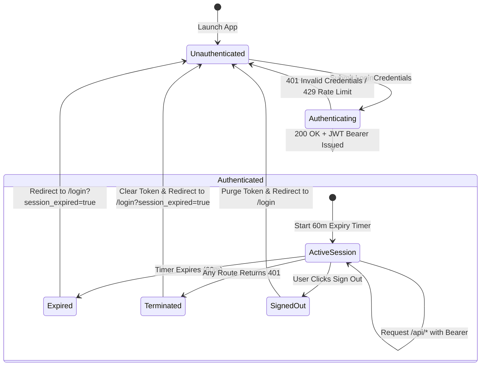
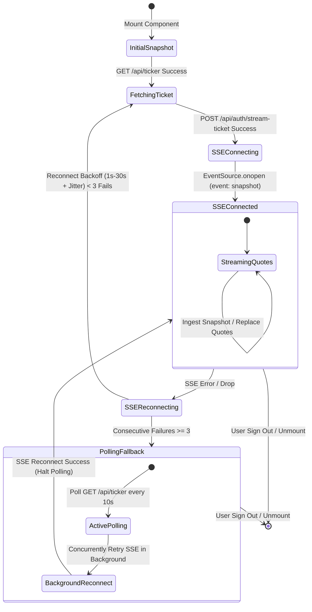
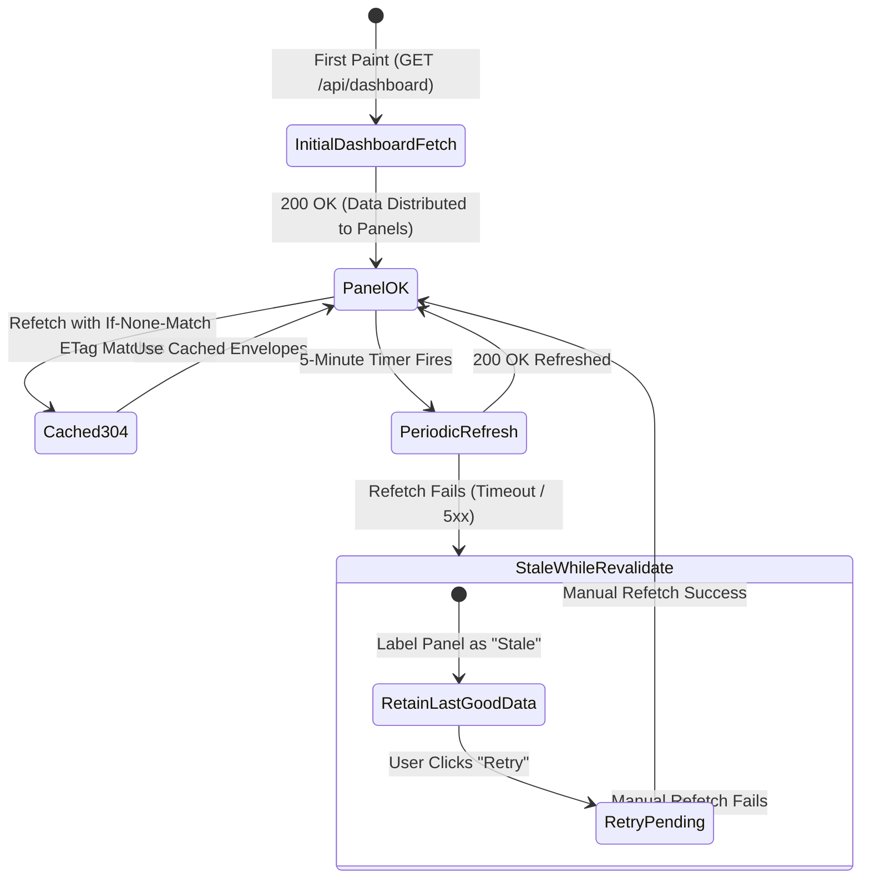

# Data Model Specification: End-to-End Live Dashboard Integration

**Feature**: [002-live-data-integration](file:///Users/tejaspatare/Documents/AdityaBirla/Economics-Indicator/specs/002-live-data-integration/spec.md)  
**Date**: 2026-10-16  
**Status**: Approved

This document details the data structures, entity models, lifecycle states, and relationship rules governing the integrated economic indicator dashboard.

---

## 1. Entity Definitions & Schemas

### 1.1 User & Authentication

#### `User` (Database Entity)
Represents a provisioned analyst account stored in the `users` PostgreSQL table.

| Field | Type | Constraints | Description |
| :--- | :--- | :--- | :--- |
| `id` | `UUID` / `SERIAL` | Primary Key | Unique user record identifier |
| `username` | `VARCHAR(100)` | Unique, Not Null | Analyst email or username |
| `password_hash`| `VARCHAR(255)` | Not Null | Bcrypt password hash generated at runtime |
| `role` | `VARCHAR(20)` | `viewer` \| `admin` | Authorization role |
| `created_at` | `TIMESTAMPTZ` | Default `NOW()` | Account creation timestamp |

#### `AuthSession` & `AuthUser` (API Envelope)
Issued upon successful authentication at `POST /api/auth/login`.

```typescript
export interface AuthUser {
  id: string;
  username: string;
  email: string;
  name?: string;
  role: 'viewer' | 'admin';
}

export interface LoginResponse {
  user: AuthUser;
  accessToken: string;
  expiresInSeconds: number; // 3600 (60 minutes)
}
```

---

### 1.2 Macroeconomic Indicators Contract (`IndicatorResponse`)

The public interface contract for every macroeconomic indicator emitted by `/api/indicators/{slug}` and `/api/dashboard`.

```typescript
export type SourceType = 'NSE' | 'external';
export type IndicatorStatus = 'ok' | 'stale' | 'unavailable';
export type DeltaDirection = 'positive' | 'negative' | 'neutral';

export interface StatTileMetric {
  label: string;
  value: number | string | null;
  formattedValue?: string;
  unit?: string;
  delta?: number | null;
  formattedDelta?: string;
  deltaUnit?: string;
  deltaDirection: DeltaDirection;
  sublabel?: string;
  iconKey?: string;
}

export interface IndicatorResponse<
  TValues = Record<string, StatTileMetric>,
  TSeries = unknown[]
> {
  id: string; // Canonical slug (e.g. 'gdp-growth')
  title: string;
  subtitle?: string;
  source: string; // Authoritative agency name
  source_type: SourceType;
  as_of: string; // Effective reporting period (e.g. 'FY2024-25')
  status: IndicatorStatus;
  values: TValues; // Dictionary of named StatTileMetric objects
  series: TSeries; // Panel-specific array of observation points
}
```

---

### 1.3 Per-Panel Specific Payloads & Series Shapes

#### Panel 1: GDP Growth (`gdp-growth`)
- **Values**:
  - `india`: `StatTileMetric` (iconKey: `'india'`)
  - `world`: `StatTileMetric` (iconKey: `'world'`)
- **Series**: `GdpGrowthPoint[]`
  ```typescript
  export interface GdpGrowthPoint {
    year: string; // '2021', '2022', ...
    indiaRate: number | null;
    worldRate: number | null;
  }
  ```

#### Panel 2: Debt to GDP Ratio (`debt-to-gdp`)
- **Values**:
  - `indiaFy25`: `StatTileMetric` (label: `'India (FY25)'`, unit: `'%'`)
  - `indVsUs`: `StatTileMetric` (label: `'Ind vs US'`, unit: `'pp'`)
- **Series**: `DebtToGdpPoint[]`
  ```typescript
  export interface DebtToGdpPoint {
    year: string;
    indiaDebt: number | null;
    usaDebt: number | null;
  }
  ```

#### Panel 3: Imports, Exports & Trade Balance (`trade-balance`)
- **Values**:
  - `exports`: `StatTileMetric` (unit: `'US$ B'`)
  - `imports`: `StatTileMetric` (unit: `'US$ B'`)
- **Series**: `TradeBalancePoint[]`
  ```typescript
  export interface TradeBalancePoint {
    year: string;
    exports: number | null; // YoY %
    imports: number | null; // YoY %
    tradeBalancePctGdp: number | null; // % of GDP, signed
  }
  ```

#### Panel 4: GST Tax Collection (`gst-collection`)
- **Values**:
  - `collections`: `StatTileMetric` (label: `'GST Collections'`, unit: `'%'`)
  - `monthlyAverage`: `StatTileMetric` (label: `'Monthly Average'`, unit: `'Rs lakh crore'`)
- **Series**: `GstCollectionPoint[]`
  ```typescript
  export interface GstCollectionPoint {
    period: string; // 'FY 20-21' or monthly label
    growthRate: number | null; // YoY %
    monthlyAverage: number | null; // Rs lakh crore
  }
  ```

#### Panel 5: Inflation (`inflation`)
- **Values**:
  - `inflationRate`: `StatTileMetric` (label: `'Inflation Rate'`, unit: `'%'`)
  - `rbiTarget`: `StatTileMetric` (label: `'RBI Target (Policy)'`, unit: `'%'`, delta: `null`)
- **Series**: `InflationPoint[]`
  ```typescript
  export interface InflationPoint {
    year: string;
    actualRate: number | null;
    targetRate: number; // 4.0 policy constant
  }
  ```

#### Panel 6: Government Expenditure (`govt-expenditure`)
- **Values**:
  - `totalExpenditure`: `StatTileMetric` (label: `'Total Expenditure'`)
  - `capitalExpenditure`: `StatTileMetric` (label: `'Capital Expenditure'`)
- **Series**: `GovtExpenditurePoint[]`
  ```typescript
  export interface GovtExpenditurePoint {
    year: string; // 'FY 21-22', 'FY 25-26 (RE)'
    total: number | null;
    capital: number | null;
    revenue: number | null;
    basis?: 'actual' | 'revised_estimate' | 'budget_estimate';
    estimate?: boolean; // true if RE or BE
  }
  ```

---

### 1.4 Market Index Quotes & Ticker Stream

#### `MarketIndexQuote`
Represents an authoritative snapshot for a single financial index.

```typescript
export interface MarketIndexQuote {
  symbol: 'NIFTY BANK' | 'NIFTY IT' | 'SENSEX';
  name: string;
  currentPrice: number; // Aliased from 'last' in backend
  last?: number;
  changePoints: number; // Aliased from 'change' in backend
  change?: number;
  changePercent: number; // Aliased from 'pct_change' in backend
  pct_change?: number;
  isPositive: boolean;
  updatedAt: string; // ISO 8601
  as_of?: string;
  source: string; // 'NSE' or 'BSE'
  market_status: 'open' | 'closed' | 'stale';
}
```

#### `TickerStreamPayload` (SSE Named Event: `"snapshot"`)
Payload emitted on every SSE push update and returned by `GET /api/ticker`.

```typescript
export interface TickerStreamPayload {
  timestamp: string; // ISO 8601
  quotes: MarketIndexQuote[];
}
```

#### `StreamTicket`
Short-lived single-use authorization ticket.

| Field | Type | Constraints | Description |
| :--- | :--- | :--- | :--- |
| `ticket` | `string` | Cryptographically random UUID | Single-use authorization token |
| `created_at` | `float` | Monotonic epoch seconds | Timestamp of issuance |
| `expires_in_seconds`| `int` | `30` | Valid lifetime before automatic revocation |

---

## 2. State Transitions & Lifecycle Diagrams

### 2.1 Analyst Authentication & Session Lifecycle



---

### 2.2 Live SSE Ticker Connection & Fallback Lifecycle



---

### 2.3 Indicator Data Freshness & Caching Lifecycle


